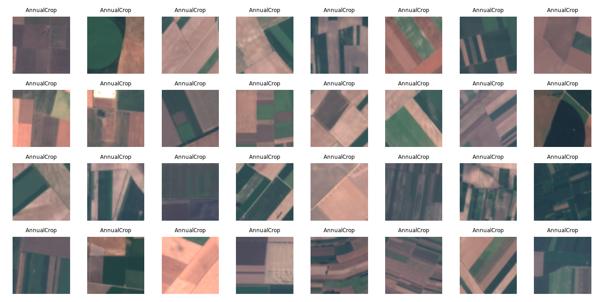
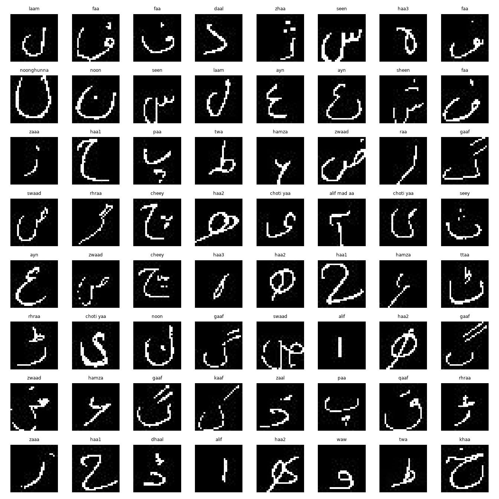
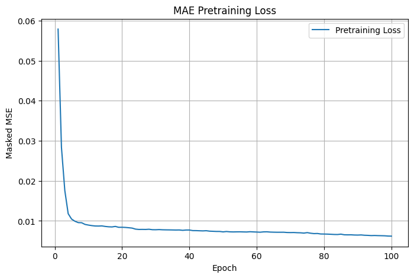
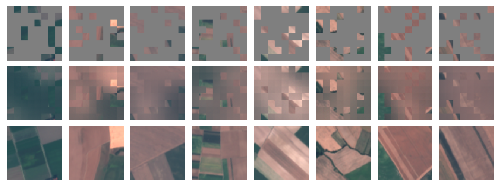
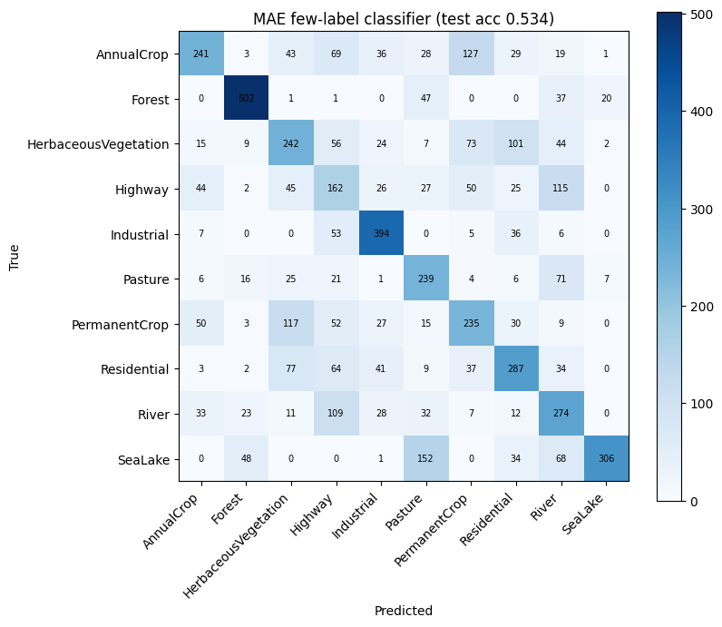

# Generative AI – Assignment 04
**Masked Autoencoders, VAEs, Diffusion and RAG — four generative models, one app**

Group members:
- Ume Kulsoom — Parts A (MAE) and D (RAG)
- Mobeen — Parts B (VAE) and C (Diffusion)

Links: [Medium blog](TODO) · [LinkedIn post](TODO) · [Trained weights](https://huggingface.co/KayTheCoderrrrrrr/four-ways-to-generate-weights)

---

## Repository layout
| Folder | Contents |
|---|---|
| `starter/` | the given starter files, unchanged |
| `part_a_mae/` | model, pretraining, reconstructions, few-label classifier |
| `part_b_vae/` | model, training, reconstructions, samples, interpolation |
| `part_c_diffusion/` | schedule, training, sampling |
| `part_d_rag/` | chunking, index, search, retrieval metrics, generation, evaluation |
| `results/` | figures, tables, `rag_answers.jsonl`, `human_eval.csv`, `analysis.md`, `samples.md` |
| `app/` | front end (4 tabs) |

## Setup
```bash
pip install -r requirements.txt
```
EuroSAT and BioASQ download automatically. For UHaT, download `data.zip` from
[Zenodo](https://zenodo.org/records/3670611) and unzip it into `starter/data/uhat/`.

## Task 0 – Starter check
```bash
cd starter
python check_starter.py
```
Output:
```
EuroSAT train (16200, 3, 64, 64) test (5400, 3, 64, 64)
few-label subset: 160 images; patches per image: (8, 64, 192)
UHaT train (28328, 1, 28, 28) test (4747, 1, 28, 28) classes: 40
BioASQ corpus: 40181 abstracts; test questions: 707
example: Is capmatinib effective for glioblastoma? | relevant ids: [31776899]
```




## How to run each part
- **Part A – MAE** (GPU; ~11 min on a T4):
  ```bash
  python part_a_mae/model.py                        # shape + correctness checks
  python part_a_mae/pretrain.py --ckpt_dir CKPT     # A.1, 100 epochs, resumable
  python part_a_mae/reconstruct.py --ckpt_dir CKPT  # A.2
  python part_a_mae/classifier.py --ckpt_dir CKPT   # A.3 + A.4
  ```
  `CKPT` is any folder (default `checkpoints/mae`). To skip training, download `mae_final.pt` and `mae_classifier.pt` from the weights link into it.
- **Part B – VAE:** TODO
- **Part C – Diffusion:** TODO
- **Part D – RAG:** TODO
- **App:** TODO

## Trained weights
All weights: https://huggingface.co/KayTheCoderrrrrrr/four-ways-to-generate-weights

| File | Part | Place in |
|---|---|---|
| `mae_final.pt` | A – pretrained MAE (encoder + decoder) | `checkpoints/mae/` |
| `mae_classifier.pt` | A – few-label linear classifier | `checkpoints/mae/` |

## Correctness checks
- **MAE:** exactly 48 of 64 patches masked per image; loss only on masked patches (predictions at visible positions replaced with noise, loss unchanged)
  ```
  CHECK masked patches per image: [48.0] (expected [48.0])
  CHECK loss only on masked patches: 0.517114 == 0.517114
  ```
- **VAE:** KL ≥ 0, and KL = 0 when µ = 0, log σ² = 0 — TODO output
- **DDPM:** ᾱ_T ≈ 4×10⁻⁵; x at t = 999 looks like noise — TODO output
- **RAG:** every chunk ≤ 150 words; every embedding has norm 1; perfect ranking gives Hit@k = Recall@k = MRR@10 = 1 — TODO output

## Results
### Table 1 – Data
| | |
|---|---|
| EuroSAT train / test images; labelled images used | 16,200 / 5,400; 160 |
| UHaT character classes; train / test images | 40; 28,328 / 4,747 |
| BioASQ abstracts; chunks; test questions | 40,181; TODO; 707 |
| Mean number of relevant abstracts per test question | |

### Table 2 – Training
| Model | Parameters | Final training loss | Time / GPU |
|---|---|---|---|
| MAE (encoder + decoder) | 3,962,752 | 0.0062 (masked MSE) | 10.7 min / Tesla T4 |
| VAE | | | |
| DDPM U-Net | | | |

### Table 3 – Image results
| | |
|---|---|
| MAE few-label classifier: test accuracy | 53.4% (chance 10%) |
| VAE: test negative ELBO = reconstruction + KL (nats) | |
| Diffusion: blind test, member 1 / member 2 correct (of 40) | |
| Diffusion: images where both members agreed (of 40) | |

### Table 4 – Retrieval
| Hit@1 | Hit@5 | Hit@10 | Recall@1 | Recall@5 | Recall@10 | MRR@10 |
|---|---|---|---|---|---|---|
| | | | | | | |

### Table 5 – Generation (100 questions)
| | |
|---|---|
| ROUGE-L | |
| Citation precision | |
| "I don't know" rate | |
| Human: supported, member 1 / member 2 (of 20) | |
| Human: correct, member 1 / member 2 (of 20) | |

## Part A figures




## App screenshots
TODO – MAE tab, VAE tab, Diffusion tab, RAG tab

> Part D answers are for educational use only. Not medical advice.